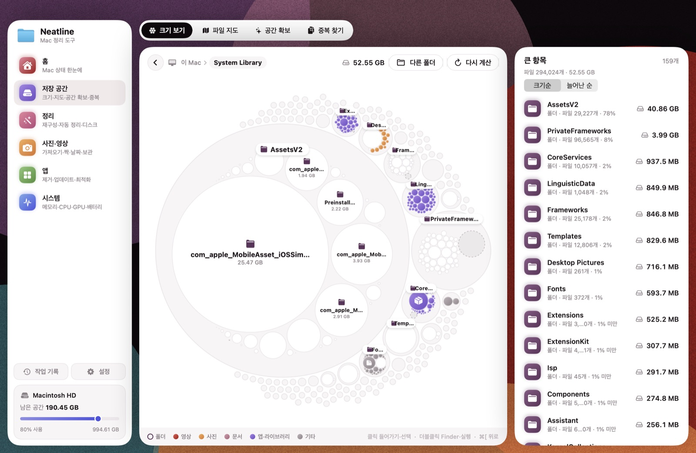
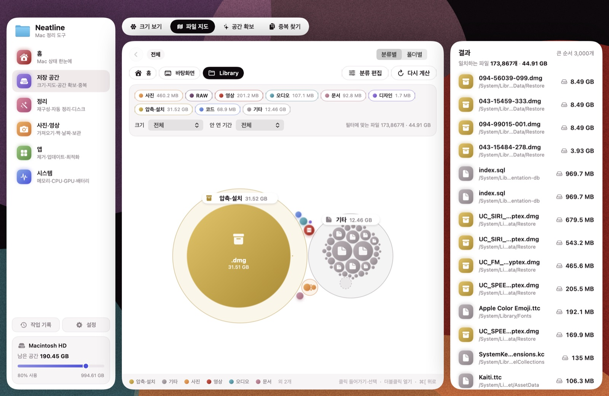
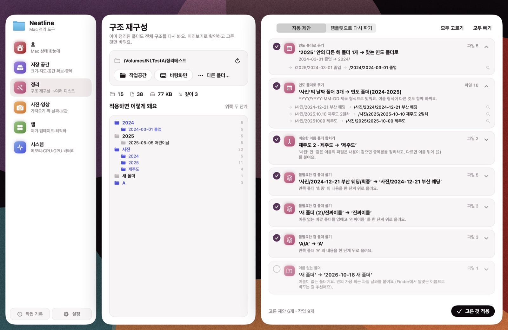
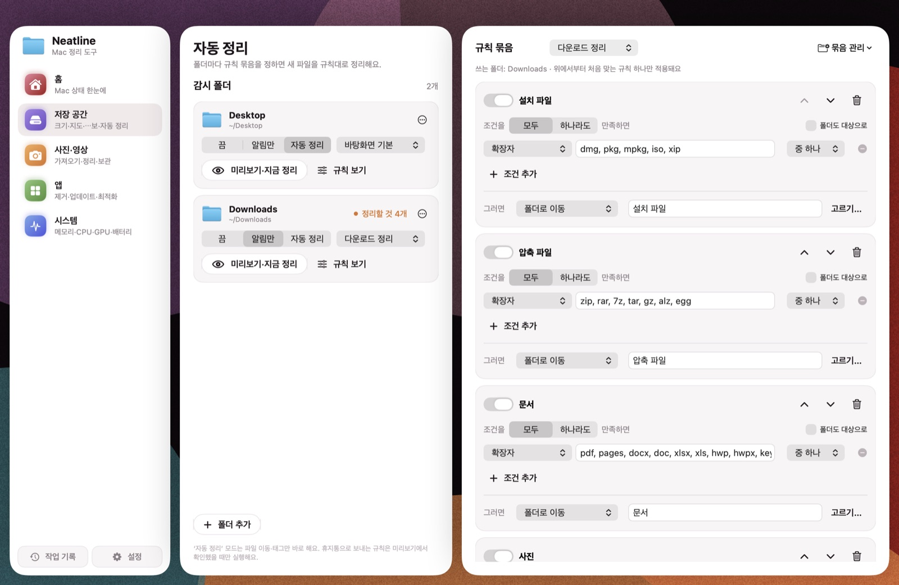

# Neatline

> 맥을 한눈에 보고, 한 번에 정리하는 앱 — 디스크 지도부터 폴더 구조 재구성, 여러 SSD·NAS 중복 정리까지.

Neatline은 macOS용 정리 도구예요. 어디에 용량이 쓰이는지 버블 지도로 보여 주고, 바탕화면·다운로드처럼 자꾸 어질러지는 폴더를 규칙대로 자동 정리하고, 이미 정리된 폴더도 더 깔끔한 구조로 다시 짜 줘요. 사진·영상 작업을 많이 하는 사람에게 특히 잘 맞아요.

*이 저장소는 설치 파일만 배포해요. 소스 코드는 비공개 저장소에 있어요.*

## 설치

터미널에 한 줄만 붙여 넣으세요. 업데이트할 때도 같은 명령이에요.

```bash
curl -fsSL https://raw.githubusercontent.com/duaghwns/Neatline-releases/main/install.sh | bash
```

또는 **[최신 릴리즈](https://github.com/duaghwns/Neatline-releases/releases/latest)** 에서 `Neatline.dmg` 를 내려받아 응용 프로그램 폴더로 끌어 놓으세요.
DMG로 설치하면 처음 열 때 "확인할 수 없는 개발자" 경고가 뜰 수 있어요 → **시스템 설정 › 개인정보 보호 및 보안** 아래쪽의 **그래도 열기**를 누르세요. (한 줄 설치는 이 경고가 뜨지 않아요.)

- macOS 14 (Sonoma) 이상 · Apple 실리콘 / 인텔 모두 지원
- 처음 실행하면 **설정 › 권한**에서 '전체 디스크 접근'을 켜 두면 폴더마다 권한을 묻지 않아요

## 스크린샷

| 크기 보기 | 파일 지도 |
|---|---|
|  |  |
| **구조 재구성** | **자동 정리** |
|  |  |

## 주요 기능

### 저장 공간
- **크기 보기** — 맥 전체 디스크부터 폴더를 버블로 타고 들어가요. 들어간 곳만 그때그때 계산해서 빨라요. 클릭은 들어가기, 더블클릭은 Finder·실행
- **파일 지도** — 사진·영상·문서·설치 파일… 종류별로 어디에 얼마나 있는지, 분류는 직접 편집
- **공간 확보** — 캐시·로그·지운 앱의 남은 파일·개발 빌드 산출물(node_modules 등)·설치 파일 정리
- **중복 찾기** — 내용까지 비교해서 똑같은 파일만

### 정리
- **구조 재구성** — 이미 정리된 폴더도 다시 봐요: 흩어진 날짜 폴더를 `연도/YYYY-MM-DD 제목`으로 묶고, `20251009 제주도`·`2025.10.10` 같은 이름 형식을 통일하고, `제주도`·`제주도 2`·`제주도 복사본`을 합치고, 쓸데없는 겹 폴더와 빈 폴더를 정리해요. 템플릿(연도/날짜 제목, 종류별)으로 전체 틀을 다시 짤 수도 있어요. 미리보기로 확인하고 고른 것만 적용, 바로 되돌리기 가능
- **자동 정리** — 바탕화면·다운로드 등 폴더마다 규칙 묶음을 정하면 새 파일을 알아서 정리. 조건(확장자·이름·크기·날짜·다운로드한 주소)과 동작(폴더로·날짜별 폴더로·태그·휴지통)을 조합, 규칙 묶음은 저장·내보내기·불러오기
- **여러 디스크** — 외장 SSD·NAS를 한꺼번에 훑어 디스크끼리 똑같은 폴더·파일을 찾고, "사진 SSD·영상 SSD"처럼 디스크 용도를 정해 두면 연결될 때 맞는 디스크로 옮길 계획을 알려 줘요

### 사진·영상
- **SD카드 가져오기** — 촬영일별 폴더로 복사, 복사 후 해시로 검증
- **RAW·JPG 짝**, **날짜 검사**, **외장 디스크 보관**(검증 후 옮기기, 끊겨도 이어서)

### 앱 · 시스템
- **앱 제거** — 앱과 남은 파일까지 · **업데이트** — 앱을 열지 않고 백그라운드 업데이트(Homebrew) · **최적화**
- **상태 요약**(건강 점수) · **메모리**(정리 포함) · **CPU·GPU** · **배터리**(성능 상태·사이클·사용 기록)
- 메뉴바에서 남은 공간·배터리·메모리를 보고 바로 정리

## 안전하게
- 절대 영구 삭제하지 않아요. 지울 때는 휴지통으로만 (NAS는 휴지통이 없어서 `Neatline 정리함` 폴더로)
- 덮어쓰지 않아요. 같은 이름이면 내용이 같을 때만 중복본을 정리하고, 다르면 이름 뒤에 (2)를 붙여요
- 옮기고 지운 모든 작업은 **작업 기록**에 남아 되돌릴 수 있어요
- 관리자 권한이 필요한 작업은 Touch ID 또는 macOS 암호 창으로 확인 (앱은 암호를 보지 못해요)
- 모든 데이터는 내 맥에만 있어요. 서버로 아무것도 보내지 않아요 (인터넷은 앱 업데이트 확인 화면에서 App Store·Homebrew 정보를 조회할 때만 써요)

## 지우기

응용 프로그램 폴더의 `Neatline.app`을 휴지통으로 옮기면 돼요. 설정·기록까지 지우려면 `~/Library/Application Support/Neatline` 폴더도 함께 지우세요.

문제 제보나 기능 요청은 [Issues](https://github.com/duaghwns/Neatline-releases/issues)에 남겨 주세요.

---

# Neatline (English)

A macOS cleanup & organizing app: bubble map of your disks, per-folder auto-organize rules, folder-structure restructuring, cross-drive (SSD/NAS) duplicate finder, app uninstaller/updater, and system status (memory, CPU/GPU, battery). Korean UI.

```bash
curl -fsSL https://raw.githubusercontent.com/duaghwns/Neatline-releases/main/install.sh | bash
```

Requires macOS 14+, Apple silicon or Intel. Nothing is ever permanently deleted — everything goes to the Trash and can be undone from the history screen.
